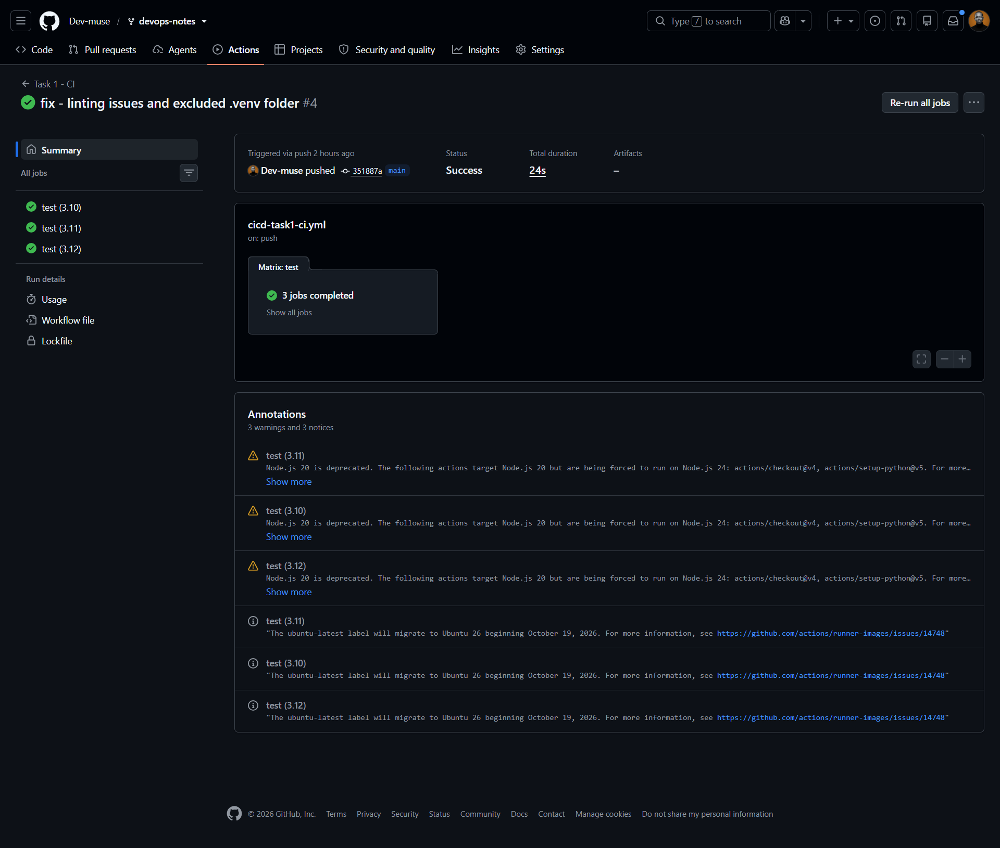
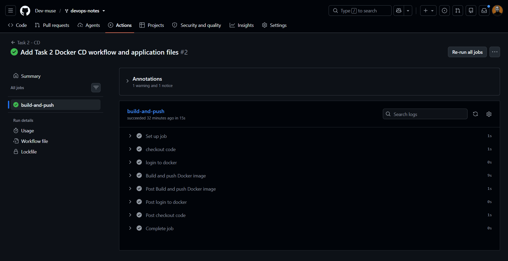
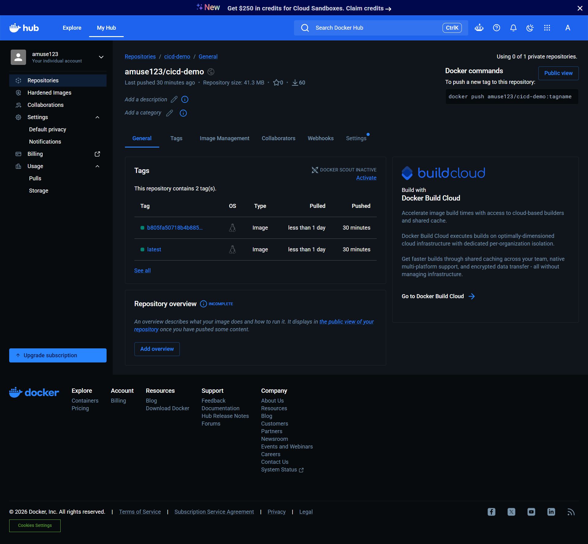

# CI/CD with GitHub Actions

## Overview
Two pipelines built while learning CI/CD:

- **Task 1 (CI):** lints and tests a Python app on every push and PR, across Python 3.10 to 3.12.
- **Task 2 (CD):** builds a Docker image and pushes it to Docker Hub on every push to `main`.

## How it works
- Task 1: `push` -> checkout -> set up Python (matrix) -> install -> flake8 -> pytest.
- Task 2: `push to main` -> login with secrets -> buildx -> build -> push `latest` and `<commit SHA>` tags.

## Pipeline files
- [`task-1/ci.yml`](task-1/ci.yml)
- [`task-2/cd.yml`](task-2/cd.yml)
(Live versions are in `.github/workflows/`.)

## What I learnt
- Difference between CI, Continuous Delivery and Continuous Deployment
- Workflow structure: events, jobs, steps, runners
- Matrix builds, caching, secrets, `workflow_dispatch`
- Tagging images with the commit SHA so every deploy is traceable

## Issues I solved
| Problem | Cause | Fix |
|---|---|---|
| Workflow didn't trigger | File was placed incorrectly or path filters didn't match the pushed directory | Adjusted path filters and confirmed workflow location in `.github/workflows/` |
| `denied: requested access to the resource is denied` | Missing or incorrect Docker Hub token / username repository secrets | Regenerated Personal Access Token and re-added repository secrets |
| Flake8 linting errors | Flake8 scanned virtual environment files inside `.venv/` | Excluded `.venv/` directory from lint checks (flake8 . --max-line-length=100 --exclude=.venv)|

## Next steps
Add deployment to AWS (ECR + ECS), OIDC instead of stored keys, Terraform plan/apply in the pipeline.